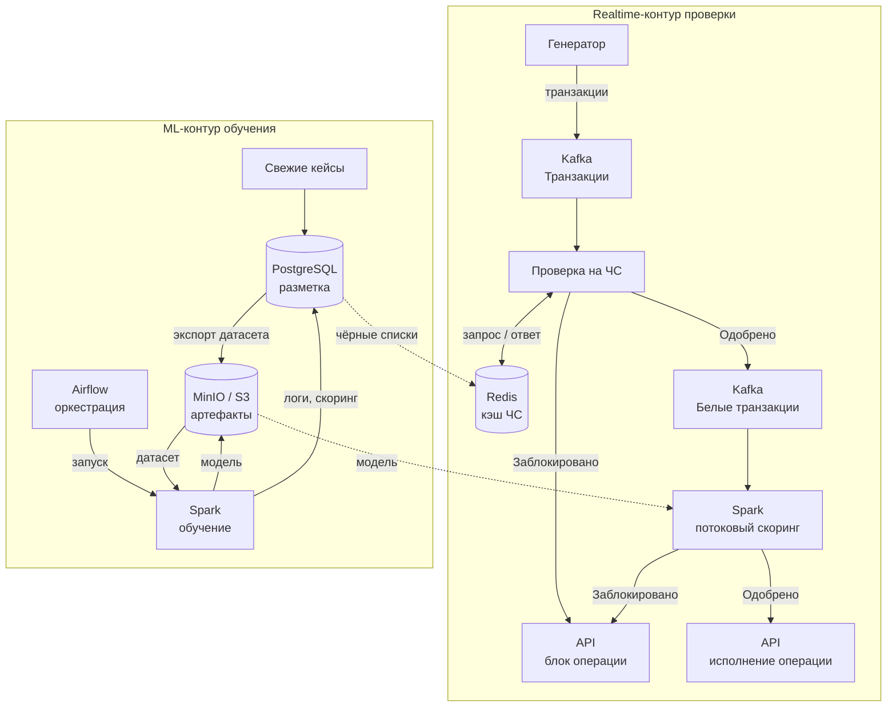

Понял, извини за путаницу. Вот полный файл `antifraud_case.md` целиком:

# Банковская антифрод система — портфолио-кейс

☀ Портфолио-кейс · Архитектура данных и ML

> Потоковая платформа выявления мошеннических операций: детерминированные проверки по чёрным спискам в реальном времени, ML-скоринг транзакций обученной моделью и замкнутый цикл переобучения на свежих кейсах.

| Поле | Значение |
| --- | --- |
| **Автор** | Дмитрий Косарев |
| **Год** | 2026 |
| **Версия документа** | 1.0 |
| **Формат** | Архитектурный кейс |

---

## Содержание

- [1. Обзор проекта](#1-обзор-проекта)
- [2. Архитектура решения](#2-архитектура-решения)
- [3. Ключевые компоненты](#3-ключевые-компоненты)
- [4. Потоки данных и сценарии](#4-потоки-данных-и-сценарии)
- [5. Хранилища данных](#5-хранилища-данных)
- [6. Технологический стек](#6-технологический-стек)
- [7. Глоссарий](#7-глоссарий)
- [8. Заключение и направления развития](#8-заключение-и-направления-развития)

---

## 1. Обзор проекта

Антифрод — это контур защиты банка, который должен принимать решение о судьбе каждой операции до того, как она исполнена, и при этом не мешать легитимным клиентам. В кейсе спроектирована сквозная архитектура: от приёма транзакционного потока до исполнения вердикта и непрерывного дообучения модели на размеченных кейсах.

### Бизнес-задача

- снижать потери от мошенничества, останавливая подозрительные операции до исполнения;
- минимизировать false-positive: легитимные операции не должны задерживаться заметно для клиента;
- принимать решения в режиме реального времени, при пиковых нагрузках платёжного потока;
- обеспечивать аудируемость: каждый вердикт фиксируется и может быть объяснен;
- постоянно улучшать качество детекции по мере накопления размеченных кейсов.

### Требования к архитектуре

- **Real-time.** Проверка транзакции укладывается в миллисекунды: кэш чёрных списков + потоковый скоринг.
- **Масштабируемость.** Шина событий развязывает продюсеров и консюмеров, компоненты масштабируются независимо.
- **Разделимость контуров.** Онлайн-проверка и офлайн-обучение модели не мешают друг другу.
- **Отказоустойчивость.** Очереди сглаживают пики и позволяют повторять обработку.
- **Воспроизводимость ML.** Датасеты, артефакты моделей и логи обучений версионируются и хранятся централизованно.

> **Ключевая идея решения** — двухслойная защита: дешёвые детерминированные правила (чёрные списки) отсекают заведомо известный фрод до тяжёлой ML-проверки, а модель ловит сложные скрытые паттерны на «белом» потоке.

---

## 2. Архитектура решения

Система состоит из двух контуров, объединённых общим хранилищем вердиктов и артефактов.

- **Realtime-контур проверки.** Генератор транзакций → Kafka → проверка по чёрным спискам (с кэшем Redis) → «белый» поток в Kafka → потоковый скоринг обученной моделью на Spark → вердикт и исполнение через API.
- **ML-контур обучения.** Свежие кейсы → разметка в Postgres → экспорт датасета в MinIO/S3 → оркестрируемое Airflow обучение на Spark → артефакт модели в MinIO → логи и скоринг обучения в Postgres → новая версия модели подхватывается скорингом.

Разделение ролей хранилищ осознанное: **Redis** держит «горячие» данные для миллисекундных обращений, **Postgres** выступает system of record (журналы вердиктов, разметка, результаты обучений), **MinIO/S3** хранит крупные бинарные артефакты ML (датасеты, модели).

> **Рис. 1 — Целевая архитектура.** Контейнеры — границы подсистем; стрелки — направление потоков данных; двунаправленная стрелка — запрос/ответ к кэшу; пунктир — связь между контурами.

---

## 3. Ключевые компоненты

### Генератор

> источник

Продюсер транзакционного потока: эмитирует события платёжных операций клиента (карточные платежи, переводы, СБП-подобные операции).

**Роль:** входная точка контура; задаёт темп и структуру событий.

### Kafka «Транзакции»

> шина

Топик сырых событий операций. Принимает пиковые нагрузки и отдаёт их консюмеру в комфортном темпе, гарантирует доставку и возможность перечитывания.

**Роль:** буфер и развязка между источником и проверяющим сервисом.

### Проверка на чёрные списки

> сервис

Первый барьер скоринга: детерминированные правила и сверка клиента/операции с чёрными списками через кэш Redis. Выносит вердикт «заблокировано» или «одобрено».

**Роль:** дешёвая фильтрация известного фрода до тяжёлой ML-проверки.

### Redis

> кэш

Кэш чёрных списков с миллисекундной латентностью; синхронизируется из Postgres. Проверка транзакции не обращается к СУБД напрямую.

**Роль:** горячие данные онлайн-проверки; защита Postgres от нагрузочного трафика.

### PostgreSQL

> storage

System of record: чёрные списки, журналы заблокированных и одобренных транзакций, размеченные данные, результаты обучений модели.

**Роль:** аудит, разметка и аналитика — всё, что требует транзакционности и SQL.

### Kafka «Белые транзакции»

> шина

Топик операций, прошедших rule-фильтр. Входной поток для ML-скоринга; позволяет независимо масштабировать и перечитывать «белый» трафик.

**Роль:** очередь на модельную проверку; разделение потоков до и после правил.

### Spark — потоковый скоринг

> streaming

Streaming-джоба проверяет белые транзакции обученной моделью (модель загружается из MinIO/S3) и выносит вердикт «заблокировано» / «одобрено».

**Роль:** второй эшелон защиты: выявление сложных неочевидных паттернов фрода.

### MinIO / S3

> object store

Объектное хранилище ML-артефактов: датасеты «данные для обучения» и версии артефакта «обученная модель».

**Роль:** версионируемый обмен большими артефактами между обучением и скорингом.

### Airflow + Обучение Spark

> orchestration

Airflow по расписанию запускает Spark-джобу обучения: чтение датасета из MinIO, обучение, сохранение модели обратно в MinIO, запись логов и скоринга в Postgres.

**Роль:** воспроизводимость и наблюдаемость ML-пайплайна: ретраи, расписание, история запусков.

### API исполнения вердиктов

> интеграция

Точки интеграции с процессингом банка: «блок операции» и «исполнение операции». Вердикт антифрода превращается в действие над платежом.

**Роль:** связка контура скоринга с банковским ядром.

---

## 4. Потоки данных и сценарии

Ниже — четыре сквозных сценария, покрывающих все ветви схемы: от блокировки по чёрному списку до замкнутого цикла переобучения модели.

### Сценарий A. Блокировка по чёрному списку

> Realtime-контур, детерминированные правила

1. **Генератор → Kafka «Транзакции».** Событие операции публикуется в топик сырых транзакций. → `Kafka`
2. **Чтение события.** Сервис проверки потребляет событие и извлекает ключи сверки (клиент, счёт, устройство, получатель). → `Проверка на ЧС`
3. **Запрос к Redis.** Сверка с чёрными списками в кэше; при промахе кэш пополняется из Postgres «Чёрные списки». → `Redis` `Postgres`
4. **Вердикт «Заблокировано» → API блока.** Попадание в ЧС: вызов API «блок операции», платёж не исполняется. → `API`
5. **Журналирование.** Транзакция фиксируется в Postgres «Список заблокированных транзакций» — аудиторский след для разборов и разметки. → `Postgres`

### Сценарий B. Чистая транзакция: одобрение моделью

> Realtime-контур, ML-скоринг

1. **Проверка по ЧС пройдена.** Попаданий в чёрные списки нет — промежуточный вердикт «Одобрено».
2. **Публикация в Kafka «Белые транзакции».** Событие уходит в топик для модельной проверки второго эшелона. → `Kafka`
3. **Скоринг на Spark.** Streaming-джоба строит признаки операции и применяет обученную модель, загруженную из MinIO/S3. → `Spark` `MinIO`
4. **Вердикт «Одобрено» → API исполнения.** Скоринг ниже порога риска: операция исполняется штатно, клиент не замечает проверки. → `API`
5. **Журналирование.** Вердикт записывается в Postgres «Список одобренных транзакций». → `Postgres`

### Сценарий C. Блокировка по вердикту модели

> Realtime-контур, ветвь риска

1. **Транзакция в «белом» потоке.** Правила и ЧС не сработали — операцию оценивает модель. → `Kafka`
2. **Скоринг выше порога.** Spark вычисляет высокий скор риска: паттерн операции похож на мошеннический. → `Spark`
3. **Вердикт «Заблокировано» → API блока.** Операция останавливается до исполнения. → `API`
4. **Журналирование и передача в разметку.** Запись в Postgres «Список заблокированных»; кейс позднее попадает в работу аналитикам и станет частью размеченных данных. → `Postgres`

### Сценарий D. Цикл обучения модели

> ML-контур, офлайн

1. **Свежие кейсы → разметка.** Разборы инцидентов и жалобы клиентов превращаются в размеченные данные в Postgres. → `Postgres`
2. **Экспорт датасета.** Размеченная выборка выгружается в MinIO/S3 как «Данные для обучения». → `MinIO`
3. **Запуск пайплайна.** Airflow по расписанию (или по готовности данных) стартует джобу «Обучение Spark». → `Airflow`
4. **Обучение и публикация модели.** Джоба читает датасет из MinIO, обучает модель и сохраняет артефакт «Обученная модель» обратно в MinIO. → `Spark` `MinIO`
5. **Логи и метрики.** Результаты обучения (логи с датой и скорингом качества) пишутся в Postgres для контроля деградации и сравнения версий. → `Postgres`
6. **Замыкание цикла.** Скоринговый Spark подхватывает новую версию модели — качество онлайн-детекции растёт без ручных деплоев. → `Spark`

---

## 5. Хранилища данных

| Хранилище | Объекты / сущности | Роль в контуре |
| --- | --- | --- |
| **PostgreSQL** | Чёрные списки; список заблокированных; список одобренных; размеченные данные; результаты обучений | System of record: аудит вердиктов, источник чёрных списков, база разметки и метрик обучений; SQL-аналитика для ML |
| **Redis** | Кэш чёрных списков | Горячий слой realtime-проверки: миллисекундная сверка без нагрузки на СУБД |
| **MinIO / S3** | Данные для обучения; обученная модель | Версионируемое хранилище больших ML-артефактов; обмен датасетами и моделями между обучением и скорингом |
| **Kafka** | Топики «Транзакции», «Белые транзакции» | Персистентный поток событий: буферизация пиков, перечитывание, развязка компонентов |

> **Принцип разделения:** «горячее» — в Redis, «истинное и аудируемое» — в Postgres, «крупное и бинарное» — в MinIO/S3, «поточное» — в Kafka. Каждое хранилище используется в своём режиме нагрузки.

---

## 6. Технологический стек

| Технология | Роль в решении | Обоснование выбора |
| --- | --- | --- |
| **Apache Kafka** | Шина событий, топики транзакций | Высокая пропускная способность, развязка продюсер/консюмер, возможность перечитывания потоков |
| **Redis** | Кэш чёрных списков | Субмиллисекундная латентность онлайн-проверки; простое обновление наборов ключей |
| **PostgreSQL** | Журналы вердиктов, разметка, метрики обучений | ACID-надёжность для аудита, зрелая SQL-аналитика для подготовки разметки |
| **Apache Spark (Streaming)** | Realtime-скоринг обученной моделью | Горизонтальное масштабирование потоковой обработки; единый движок с обучением |
| **Apache Spark (обучение)** | Обучение модели на датасете из MinIO | Тот же движок, что и в скоринге: меньше расхождений train/inference-кода |
| **Apache Airflow** | Оркестрация ML-пайплайна | DAG-пайплайны, расписания, ретраи, наблюдаемость исторических запусков |
| **MinIO / S3** | Датасеты и артефакты моделей | S3-совместимость, версионирование объектов, дешёвое хранение больших артефактов |
| **API-интеграции** | Блок / исполнение операции | Синхронная связь вердиктов с процессингом банка без изменения банковского ядра |

---

## 7. Глоссарий

| Термин | Определение |
| --- | --- |
| **Антифрод** | Комплекс средств выявления и предотвращения мошеннических операций до их исполнения. |
| **Чёрный список** | Набор запрещённых ключей (клиенты, счета, устройства, получатели); попадание транзакции в список ведёт к блокировке. |
| **Скоринг** | Числовая оценка риска операции, вычисляемая моделью; сравнивается с порогом для вердикта. |
| **Признаки (features)** | Вычисляемые характеристики транзакции и контекста, подаваемые на вход модели. |
| **Размеченные данные** | Исторические кейсы с известным ответом «фрод / не фрод»; основа для обучения модели. |
| **Артефакт модели** | Сохранённый результат обучения (веса, метаданные), готовый к загрузке скорингом. |
| **Оркестратор** | Система управления пайплайнами (Airflow): порядок задач, расписания, повторные запуски. |
| **Стриминговая обработка** | Обработка событий непрерывно по мере поступления, с латентностью порядка секунд и ниже. |
| **System of record** | Источник истины: хранилище, где данные фиксируются транзакционно и неизменяемо для аудита. |
| **Топик Kafka** | Именованный журнал событий; продюсеры пишут в топик, консюмеры читают его независимо. |

---

## 8. Заключение и направления развития

### Итоги кейса

- Спроектирован сквозной контур антифрода: от приёма события до исполнения вердикта и журналирования каждого решения.
- Двухслойная детекция (чёрные списки + ML-скоринг) снижает нагрузку на модель и ускоряет остановку известного фрода.
- Замкнутый ML-цикл (разметка → датасет → обучение → артефакт → скоринг) обеспечивает непрерывное улучшение качества без ручных деплоев.
- Все вердикты аудируемы: журналы заблокированных и одобренных операций хранятся в system of record.

### Сильные стороны архитектуры

- слабая связанность компонентов через Kafka: каждый узел масштабируется и развивается независимо;
- разделение онлайн- и офлайн-нагрузок: обучение не влияет на латентность проверок;
- заменяемость: модель, правила и даже движки можно менять без перестройки контура;
- наблюдаемость ML: логи обучений с датами и скорингом позволяют отслеживать деградацию качества.

### Направления развития

- мониторинг дрейфа признаков и автоматический триггер переобучения;
- feature store для согласованного расчёта признаков в train и inference;
- ML CI/CD: регрессионные тесты моделей и canary-вывод новых версий на часть трафика;
- дополнительные эшелоны правил: графовая аналитика связей, device-фингерпринтинг;
- автомасштабирование скоринга и тюнинг порогов по бизнес-метрикам (баланс потерь и false-positive).

