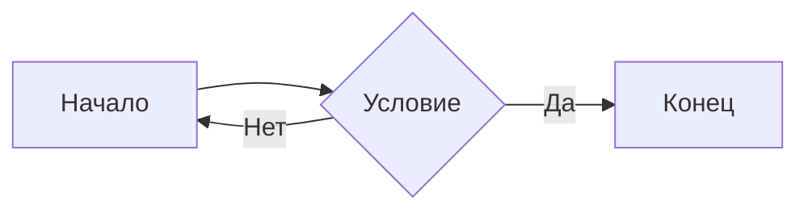

# Демонстрация Markdown

## 1. Заголовки
# H1
## H2
### H3
#### H4
##### H5
###### H6

Заголовок 1
===========
Заголовок 2
-----------

## 2. Выделение

*курсив*, _курсив_, **жирный**, __жирный__, ***жирный курсив***,
~~зачёркнутый~~, ==подсвеченный==, H~2~O, X^2^

## 3. Списки

- Пункт 1
  - Вложенный
    - Ещё глубже
- Пункт 2

1. Первый
2. Второй
   1. Вложенный
   2. Ещё

- [x] Сделано
- [ ] Не сделано

## 4. Ссылки и изображения

[Обычная ссылка](https://example.com)
[С подсказкой](https://example.com "Заголовок")
<https://auto-link.com>
[Ссылочный стиль][ref]

[ref]: https://example.com "Заголовок ссылки"


## 5. Код

Инлайн: `const x = 42;`

```js
function hello(name) {
  console.log(`Привет, ${name}!`);
}
```

    Отступ в 4 пробела — тоже блок кода.

## 6. Цитаты

> Основная цитата
>> Вложенная
>>> И ещё уровень

## 7. Таблица

| Лево  | Центр | Право |
|:------|:-----:|------:|
| a     | b     | c     |
| 1     | 2     | 3     |

## 8. Горизонтальные линии

---
***
___

## 9. Экранирование

\*не курсив\*, \_не подчёркнуто\_, \`не код\`, \# не заголовок

## 10. HTML

<b>Жирный</b>, <i>курсив</i>, <kbd>Ctrl</kbd>+<kbd>C</kbd>,
H<sub>2</sub>O, X<sup>2</sup>, <br> перенос

<details>
<summary>Спойлер (нажми)</summary>

Скрытый текст внутри.
</details>

## 11. Сноска

Текст со сноской[^note].

[^note]: Содержимое сноски.

## 12. Список определений

Markdown
: Лёгкий язык разметки

GFM
: GitHub Flavored Markdown

## 13. Математика

Инлайн: $E = mc^2$

Блочно:

$$
\int_0^\infty e^{-x^2}\,dx = \frac{\sqrt{\pi}}{2}
$$

## 14. Mermaid



## 15. Прочее

- Автоссылка: https://example.com
- Эмодзи: :rocket: :smile:
- Упоминание: @user
- Хэштег: #markdown