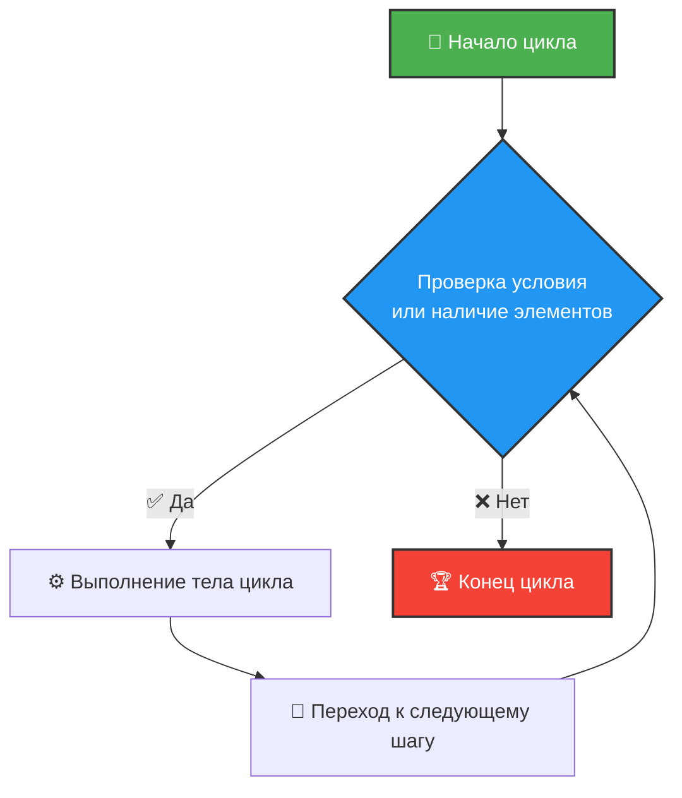

# 🔄 Циклы в Python: Полное руководство

> 💡 **Главная идея:** Циклы позволяют нам автоматизировать повторяющиеся задачи. Вместо того чтобы писать один и тот же код 100 раз, мы пишем его один раз и говорим компьютеру: *"Повтори это N раз"* или *"Повтори это, пока условие истинно"*.

В Python есть два основных типа циклов: **`for`** и **`while`**. Давайте разберем, как они работают, чем отличаются и как ими управлять.

---

## 🗺️ Как работает цикл (Алгоритм)

Прежде чем писать код, давайте посмотрим на общую логику любого цикла:



---

## 1️⃣ Цикл `for` (Перебор коллекций)

Цикл `for` в Python используется для **итерации по последовательности** (списку, строке, словарю, кортежу или диапазону). Он больше похож на цикл `foreach` из других языков.

### 📝 Синтаксис
```python
for элемент in последовательность:
    # Тело цикла (что делать с каждым элементом)
```

### 🍎 Пример: Перебор списка
```python
fruits = ["🍎 Яблоко", "🍌 Банан", "🍒 Вишня"]

for fruit in fruits:
    print(f"Я люблю есть: {fruit}")
```

### 🔢 Функция `range()`
Если вам нужно повторить действие определенное количество раз, используйте `range()`.
* `range(stop)` — от 0 до stop-1
* `range(start, stop)` — от start до stop-1
* `range(start, stop, step)` — от start до stop-1 с шагом step

```python
# Выведет числа от 1 до 5
for i in range(1, 6):
    print(i) 

# Выведет четные числа от 0 до 10
for i in range(0, 11, 2):
    print(i)
```

---

## 2️⃣ Цикл `while` (Цикл с условием)

Цикл `while` выполняется до тех пор, **пока его условие истинно (`True`)**. Используйте его, когда не знаете заранее, сколько раз нужно повторить действие.

### 📝 Синтаксис
```python
while условие:
    # Тело цикла
```

### 🚀 Пример: Обратный отсчет
```python
count = 5

while count > 0:
    print(f"Осталось секунд: {count}")
    count -= 1  # ⚠️ Важно: не забываем изменять переменную, иначе будет бесконечный цикл!

print("🚀 Пуск!")
```

> ⚠️ **Осторожно! Бесконечный цикл**
> Если условие `while` никогда не станет `False`, программа зависнет. Чтобы прервать такую программу в терминале, нажмите `Ctrl + C`.

---

## 🎛️ Управление циклами

Иногда нам нужно изменить стандартное поведение цикла: выйти из него досрочно или пропустить шаг. Для этого есть три ключевых слова:

| Команда | Что делает | Аналогия из жизни |
| :--- | :--- | :--- |
| **`break`** | Полностью прерывает выполнение цикла. | 🛑 Выйти из магазина, не дожидаясь конца покупок. |
| **`continue`** | Пропускает текущую итерацию и переходит к следующей. | ⏭️ Пропустить плохую песню в плейлисте. |
| **`pass`** | Пустая операция. Ничего не делает (заглушка). | 🤷‍♂️ "Я подумаю об этом позже" (чтобы код не выдавал ошибку). |

### 🛑 Пример `break`
```python
for num in range(10):
    if num == 5:
        print("Нашли пятерку, выходим!")
        break
    print(num)
# Выведет: 0, 1, 2, 3, 4
```

### ⏭️ Пример `continue`
```python
for num in range(5):
    if num == 2:
        continue # Пропускаем двойку
    print(num)
# Выведет: 0, 1, 3, 4
```

---

## 🪆 Вложенные циклы

Цикл может находиться внутри другого цикла. Внутренний цикл выполняется полностью для *каждого* шага внешнего цикла.

```python
# Таблица умножения (фрагмент)
for i in range(1, 4):          # Внешний цикл (строки)
    for j in range(1, 4):      # Внутренний цикл (столбцы)
        print(f"{i} * {j} = {i*j}", end="  ")
    print() # Перенос строки
```
**Результат:**
```text
1 * 1 = 1  1 * 2 = 2  1 * 3 = 3  
2 * 1 = 2  2 * 2 = 4  2 * 3 = 6  
3 * 1 = 3  3 * 2 = 6  3 * 3 = 9  
```

---

## 🐍 Pythonic Way: Генераторы списков (List Comprehensions)

В Python циклы часто записывают в одну строку, если нужно создать новый список на основе старого. Это называется *списковое включение*.

**Обычный цикл:**
```python
squares = []
for x in range(5):
    squares.append(x**2)
```

**Генератор списка (красиво и быстро):**
```python
squares = [x**2 for x in range(5)]
# Результат: [0, 1, 4, 9, 16]
```

---

## 📊 Шпаргалка: `for` vs `while`

| Характеристика | `for` | `while` |
| :--- | :--- | :--- |
| **Когда использовать?** | Когда известно количество итераций или есть коллекция для перебора. | Когда количество итераций неизвестно и зависит от условия. |
| **Условие выхода** | Закончились элементы в коллекции. | Условие стало `False`. |
| **Риск бесконечного цикла** | Низкий (если коллекция конечна). | Высокий (если забыть обновить переменную условия). |
| **Пример** | Перебор файлов в папке. | Ожидание ответа от сервера. |

---

### 🎯 Итог
* Используйте **`for`**, чтобы перебирать коллекции (списки, строки) или использовать `range()`.
* Используйте **`while`**, когда цикл должен крутиться до выполнения определенного условия.
* Помните про **`break`** и **`continue`** для гибкого управления.
* Изучите **генераторы списков**, чтобы писать код в стиле настоящего Python-разработчика! 🚀